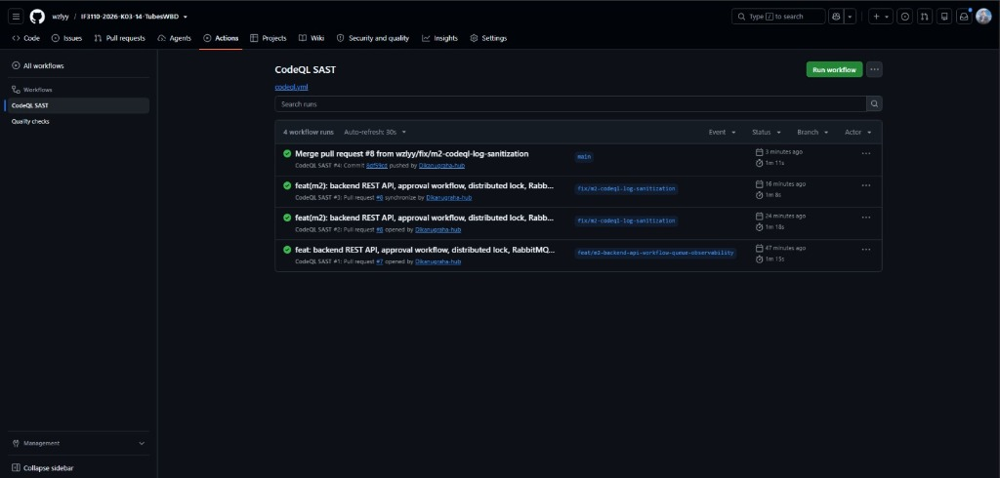
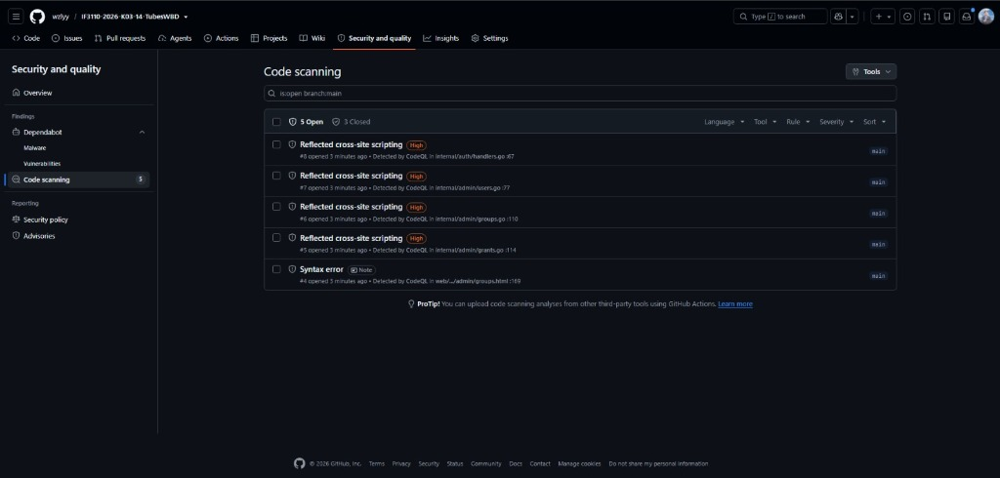
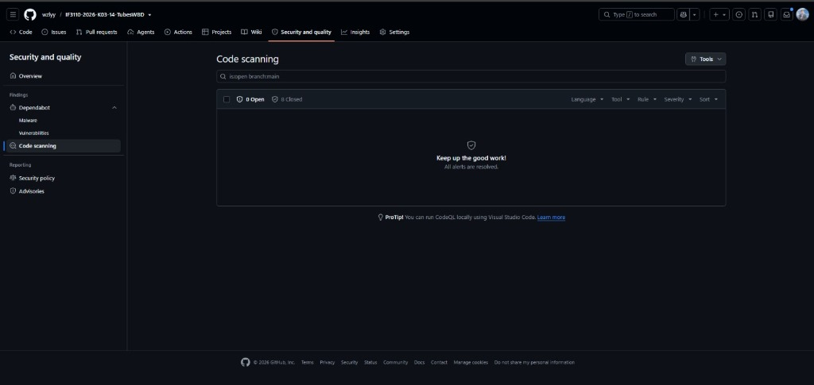

# Database Management Platform

**IF3110 Pengembangan Aplikasi Web · K03-14 · Milestone 2**

Platform ini memberi grup akses ke database PostgreSQL dan menyediakan alur untuk meninjau, menyetujui, mengeksekusi, serta membatalkan migrasi. Login, administrasi, schema/data viewer, EXPLAIN, schema diff, editor migrasi, approval, monitor job dan riwayat tersedia di satu SPA.

| Anggota | Tanggung jawab M2 |
|---|---|
| Dika Pramudya Nugraha (13524132) | API Go, skema platform, workflow dan approval, lock, publisher, instrumentasi, CodeQL dan skenario k6 |
| Wildan Abdurrahman Ghazali (13524054) | SPA responsif, worker dan recovery, dataset batch, stack observabilitas, benchmark dan analisis |
| Hafizh Hananta Akbari (13522132) | - |

## Menjalankan aplikasi

Gunakan Docker Compose v2. Pada PowerShell, salin konfigurasi jika belum ada.

```powershell
if (!(Test-Path .env)) { Copy-Item .env.example .env }
```

Isi `ADMIN_INITIAL_PASSWORD` dan `ENCRYPTION_KEY` di `.env`. Kunci harus tepat 32 byte, misalnya 32 karakter ASCII acak. Simpan kunci yang sama selama volume platform masih digunakan karena password koneksi target dienkripsi dengan kunci tersebut. Port platform bawaan 5432 dapat diganti melalui `PLATFORM_DB_PORT` jika sudah dipakai PostgreSQL lokal. Gunakan password privat untuk layanan yang akan dibuka di luar mesin pengembangan.

```powershell
docker compose up -d --build --wait
docker compose exec backend-api /app/seed
```

Buka [aplikasi lokal](http://localhost:8080). Seed opsional membuat dua koneksi target dengan host internal Compose, dua grup, serta empat pengguna demo. Login admin memakai password dari `.env`. Untuk menetapkan password demo sendiri pada seed pertama, jalankan `docker compose exec -e SEED_USER_PASSWORD=<password-demo> backend-api /app/seed`. Seed bawaan memakai `DevPass!2026` dan tidak mengganti password pengguna yang sudah ada.

| Pengguna demo | Akses |
|---|---|
| editor_core | VIEW_EDIT pada kedua target |
| leader_core | Leader team-core pada kedua target |
| leader_analytics | Leader team-analytics dengan VIEW_ONLY pada target pertama |
| viewer_analytics | VIEW_ONLY pada target pertama |

Untuk mengaktifkan Grafana, jalankan `docker compose -f compose.yaml -f compose.observability.yaml up -d --build`. Dashboard tersedia di [Grafana lokal](http://localhost:3000/d/migration-platform). Hentikan stack dengan `docker compose -f compose.yaml -f compose.observability.yaml stop` untuk mempertahankan data.

## Alur penggunaan

1. Login sebagai admin untuk mengatur pengguna, anggota dan leader grup, koneksi, serta grant. Hak admin dan hak akses target diberikan terpisah.
2. Login sebagai editor, pilih database, dan tinjau skema/data. Editor dapat memeriksa SQL dengan EXPLAIN atau menggunakan DDL hasil schema diff sebagai awal draft.
3. Buat definisi migrasi dengan SQL up dan down, atau isi alasan irreversible. Tombol validasi memeriksa aturan SQL dan, untuk batch, katalog cursor di target. Ajukan request lalu submit untuk ditinjau.
4. Setiap leader grup yang memiliki grant pada target menyetujui SQL melalui antrean review. Target pertama membutuhkan kedua leader demo, target kedua cukup leader_core. Enqueue mengembalikan job ID. Monitor menampilkan hasil worker dan progres commit.
5. Buka riwayat untuk melihat SQL, versi, percobaan gagal dan eksekusi sukses. **Hide rollback** menyembunyikan pasangan eksekusi dan rollback berdasarkan execution ID. Rollback berlaku pada active tip yang reversible. Forward, resume dan revert memerlukan persetujuan baru.

## Arsitektur dan penyimpanan

```text
Browser → React / TypeScript / Vite → Go REST /api/v1 → PostgreSQL platform
                                           ↓
                                     RabbitMQ durable
                                           ↓
                                Go worker pool + DB lease
                                           ↓
                                  PostgreSQL target 1 / 2

API + worker → OTel Collector → Tempo (traces) / Loki (logs)
Prometheus → scrape API dan worker → Grafana
```

| Lokasi | Data dan fungsi |
|---|---|
| Platform PostgreSQL | `users`, `groups`, `user_groups`, sesi, koneksi target terenkripsi serta grant VIEW_ONLY/VIEW_EDIT |
| Definisi dan review | `migration_definitions` menyimpan revisi SQL dan pengaturan batch. `migration_requests` mereferensikan definisi dan eksekusi sasaran. `migration_approvals` merekam keputusan per grup |
| Eksekusi di platform | `migration_executions` menyimpan satu attempt dengan salinan SQL. `execution_batch_progress` menyimpan progres yang dibaca SPA. `database_locks` membatasi satu migrasi aktif per database |
| PostgreSQL target | Skema `_platform_meta` menyimpan execution proof, checkpoint dan snapshot pembatalan dalam transaksi yang sama dengan perubahan data |

Skema platform lengkap tersedia di [migrasi SQL](migrations/platform/005_m2_schema.sql). API memeriksa sesi, CSRF dan grant pada server. Worker memeriksa kembali approval grup, urutan linear dan active tip setelah memperoleh lock. `WORKER_CONCURRENCY` mengatur paralelisme worker (bawaan 4).

### Bila worker terhenti

Worker memperbarui lease 30 detik setiap 10 detik. Pesan persisten memakai acknowledgment manual. Pada redelivery, worker memeriksa status attempt dan lock. Jika lease kedaluwarsa sebelum attempt tercatat, lock dapat diambil kembali. Jika transaksi sudah mungkin berjalan, worker menahan database dalam `held_uncertain`, mengambil advisory lock di target dan memeriksa bukti commit sebelum mengambil keputusan. Token lease mencegah worker lama meneruskan transaksi setelah kepemilikan berpindah. Ketika target belum dapat dihubungi, pesan verifikasi dijadwalkan kembali. Retry eksekusi SQL sementara dibatasi hingga tiga kali.

Migrasi normal menulis proof bersama SQL dalam satu transaksi. Pada batch, worker menangkap batas awal cursor, membaca rentang keyset terurut, lalu melakukan commit per rentang. Gunakan satu UPDATE pada tabel yang dikonfigurasi, dengan cursor unik, NOT NULL, dan stabil. SQL dapat memakai `WHERE id BETWEEN $1 AND $2`. Batch reversible menyimpan keadaan baris sebelum dan sesudah pembaruan. Jika gagal setelah sebagian commit, `held_partial` melindungi database. Resume memulai dari checkpoint terakhir. Revert menjalankan SQL kompensasi yang disetujui atas key yang tercatat dalam urutan batch terbalik dan menolak baris yang berubah dari snapshot. Bila kompensasi terputus, progres yang sudah direvert tersimpan.

Dalam pengujian restart, worker dimatikan setelah monitor melaporkan tiga checkpoint. Sesudah RabbitMQ dan worker hidup kembali, target membuktikan empat batch telah committed. Request resume menyelesaikan 96 sisanya. Pada akhir uji, seluruh 500.000 baris memiliki saldo 1.003 sesuai satu kali pembaruan per baris.

## Pengujian

```powershell
go test -p 1 -count=1 ./...
go vet ./...
go build ./cmd/server ./cmd/worker ./cmd/seed
docker compose -p wbd-test -f compose.test.yaml up -d --wait
.\scripts\test-integration.ps1
docker compose -p wbd-test -f compose.test.yaml stop
npm --prefix frontend ci
npm --prefix frontend run build
```

Go mengikuti versi di `go.mod`. Untuk pengembangan SPA jalankan `npm --prefix frontend run dev` di samping API lokal pada port 8080. Vite mem-proxy `/api` ke Go. Image produksi menyalin hasil build ke `/app/frontend/dist`. Kontainer pengujian memakai database dan port khusus. Skenario worker mencakup serialisasi per target, eksekusi paralel dua target, duplicate delivery, partial/resume, kegagalan revert, revalidasi approval, batch crash recovery, 0-batch unsafe revert, antrean saat `held_uncertain`, dan pemulihan commit setelah lease kedaluwarsa.

Pada 500.000 baris, satu UPDATE membutuhkan **6,155 detik**. Worker batch reversible menyelesaikan **50 × 10.000 baris dalam 16,804 detik**. Pengukuran mencakup satu putaran lokal. [Metode, SQL dan hasil benchmark](docs/batch-benchmark.md)

### Hasil k6

Setelah seed, jalankan `.\tests\k6\setup_preapproved.ps1` (kuota bawaan 30 job per DB / 60 job total; dapat diubah lewat `-CountPerDB`). Terapkan nilai variabel lingkungan yang dicetak oleh skrip, lalu jalankan `k6 run --out json=k6-points.json tests/k6/stress_test.js`. Jika menggunakan password seed khusus, teruskan `-Password` ke skrip persiapan dan set `K6_PASSWORD` sebelum k6. Gunakan database pengujian karena request yang disiapkan akan benar-benar dieksekusi.

Skrip [`tests/k6/stress_test.js`](tests/k6/stress_test.js) menjalankan tiga skenario secara bersamaan: (1) `api_read_stress` (`ramping-vus`) yang menaikkan trafik baca `GET /databases`, `/history`, dan `/schema` melalui tahap `0 → 10 → 30 → 60 → 100 VU` lalu turun kembali `10 → 0 VU`, (2) `same_db_migration_jobs` (`1 VU`) yang mengirim 30 job pra-persetujuan `target-postgres-1` secara berpasangan di lima `load_stage` dengan menunggu job pertama mencapai `running`/terminal (`waitUntilRunningOrTerminal`) sebelum meng-enqueue pasangannya agar kontensi *distributed lock* teruji tanpa melanggar urutan versi linear, serta (3) `diff_db_migration_jobs` (`1 VU`) yang mengirim 30 job `target-postgres-2` paralel lintas lima tahap yang sama. Polling `GET /api/v1/jobs/{job_id}` memprioritaskan `request_status` hingga terminal sehingga `202 Accepted` tidak dihitung sebagai keberhasilan eksekusi, dengan threshold eksplisit `http_req_duration` `p(95)<500`, `http_req_failed` `rate<0.02`, dan `migration_job_success_rate` `rate>0.95` (atau `K6_JOB_MODE=burst` untuk pengiriman serentak di awal).

Pada run pengukuran **27 November 2026** (`K6_JOB_MODE=staged`, 30 job `same_db` + 30 job `diff_db`, total durasi **171,16 detik**), seluruh threshold k6 lulus: **`p95` HTTP 36,42 ms** (`< 500 ms`), **error rate HTTP 0,00%** (`0 / 35.144`, `< 2%`), throughput agregat **205,33 req/s**, dan **60 / 60 job sukses (`100,00%`)** dengan `queue_wait` `p50 = 45,0 ms` / `p95 = 2.066,95 ms` serta durasi penyelesaian job `p50 = 369,0 ms` / `p95 = 2.649,40 ms`.

| Jendela waktu (tahap beban) | HTTP selesai (req/s) | HTTP p50 / p95 (ms) | Error | Job selesai (job/s) | Queue wait p50 / p95 (ms) | Durasi job p50 / p95 (ms) |
|---|---:|---:|---:|---:|---:|---:|
| `0–30s` (`0 → 10 VU` / `baseline_10vu`) | 1.018 (33,93) | 7,85 / 15,80 | 0% | 11 (0,367) | 45,0 / 2.113,50 | 367,0 / 2.557,50 |
| `30–60s` (`10 → 30 VU` / `ramp_30vu`) | 3.700 (123,33) | 8,58 / 28,64 | 0% | 12 (0,400) | 48,5 / 2.113,10 | 354,0 / 2.575,95 |
| `60–90s` (`30 → 60 VU` / `ramp_60vu`) | 8.023 (267,43) | 8,05 / 30,15 | 0% | 15 (0,500) | 42,0 / 2.051,00 | 373,0 / 2.645,50 |
| `90–120s` (`60 → 100 VU` / `peak_100vu`) | 13.609 (453,63) | 10,26 / 48,20 | 0% | 14 (0,467) | 44,0 / 2.047,40 | 353,5 / 2.666,45 |
| `120–150s` (`100 → 10 VU` / `recovery_10vu`) | 8.310 (277,00) | 6,46 / 24,90 | 0% | 8 (0,267) | 43,5 / 2.138,35 | 346,0 / 2.473,25 |
| `150s–akhir` (17,59s, `10 → 0 VU`) | 483 (27,45) | 8,95 / 29,79 | 0% | 0 (0,000) | — | — |

**Analisis perilaku tiap tingkat beban & pemulihan:**
1. **Baseline & Ramp-up Awal (`0–60s`, `0 → 30 VU`):** Latensi HTTP meningkat terkendali dari `p50 = 7,85 ms` / `p95 = 15,80 ms` (`33,93 req/s`) menjadi `p50 = 8,58 ms` / `p95 = 28,64 ms` (`123,33 req/s`), dengan 23 job selesai tanpa error (`queue_wait p50 ~45–48,5 ms`).
2. **Beban Tinggi–Puncak (`60–120s`, `30 → 100 VU`):** Pada `60–90s`, throughput naik ke `267,43 req/s` (`p95 = 30,15 ms`, maksimum `180,90 ms`), lalu memuncak pada `90–120s` di **`453,63 req/s`** (`13.609` request) dengan `p50 = 10,26 ms`, `p95 = 48,20 ms`, dan `0%` error. Kinerja API tetap responsif karena eksekusi migrasi diproses worker secara asinkron di balik queue (`16` job bertag `peak_100vu` selesai `100%`, `queue_wait p50 = 42,5 ms`).
3. **Pemulihan (`120s–akhir`, `100 → 0 VU`) & Perbandingan DB:** Ketika beban diturunkan kembali ke `10 → 0 VU`, latensi API langsung pulih (`p50` turun ke `6,46 ms` dan `p95` ke `24,90 ms` pada `120–150s`), seluruh 8 job sisa tuntas, dan `database_locks` kembali `0`. Antara kedua target, `diff_db` berjalan langsung tanpa bentrok lock (`queue_wait p50 = 40,0 ms` / `p95 = 60,65 ms`, selesai `p95 = 321,20 ms`), sedangkan `same_db` menunjukkan distribusi bimodal (`queue_wait p50 = 1.084,0 ms` / `p95 = 2.180,00 ms`, selesai `p95 = 2.671,85 ms`) karena job kedua di setiap pasangan terhalang lock aktif (`ErrLockBusy`) dan menunggu backoff retry `2 detik` di [`internal/worker/consumer.go`](internal/worker/consumer.go#L148) sebelum dieksekusi berurutan.

[Rekap lengkap metrik, per tahap `load_stage`, perbandingan `same_db` vs `diff_db`, dan analisis](docs/k6-raw-results.md)

### Observabilitas dan CodeQL

Log JSON `log/slog` membedakan transaksi (`sql.tx_start`, `sql.tx_end`) dan eksekusi pernyataan (`sql.start`, `sql.result`), menyertakan `actor`, `database`, `correlation_id`, `trace_id`, `span_id`, metadata migrasi/batch, `sqlstate` saat gagal, serta menyamarkan kredensial/parameter sensitif dengan `[REDACTED]`. Saat alur migrasi berjalan, trace OpenTelemetry berantai menghubungkan span `HTTP POST enqueue → api.migration.enqueue → queue.publish → worker.consume → lock.acquire → db.tx → db.sql.tx_exec`, dikirim ke Tempo/Loki melalui OTel Collector, serta dilengkapi metrik Prometheus `/metrics` berkardinalitas rendah dengan label pool `db_role` seragam (`platform` dan `target_postgres`). [Contoh nyata log SQL JSON, span OTel/Tempo, dan sampel `/metrics`](docs/observability.md)

Workflow CodeQL ([`.github/workflows/codeql.yml`](.github/workflows/codeql.yml)) menganalisis kode **Go** (`autobuild`: `cmd/*` dan `internal/*`) serta **JavaScript/TypeScript** (`frontend/src/*` dan `tests/k6/stress_test.js`) menggunakan query `security-extended` dan `security-and-quality`. Sepanjang pengembangan M2, GitHub CodeQL mencatat total **10 alert (`#1`–`#10`)** yang seluruhnya telah ditangani hingga status **`0 Open`**:
- **Diperbaiki di kode:** (1) `go/log-injection` (*Medium*, CWE-117) pada `internal/telemetry/logger.go` & `redact.go` (penghapusan `\r`/`\n` dan rekonstruksi `slog.Attr` per tipe pada [`6ede7c2`](https://github.com/wzlyy/IF3110-2026-K03-14-TubesWBD/commit/6ede7c2), diikuti *dismiss* residu taint abstrak via `any` sebagai *false positive* karena `slog.NewJSONHandler` otomatis melakukan JSON-escaping), (2) Alert `#9` `go/sql-injection` (*High*, CWE-89) pada `internal/telemetry/sqllog.go:147` akibat closure `ValidateSQL` hingga `executor_normal.go` (diperbaiki dengan lexer offset integer `lexSQL` dan `SplitPostgresStatements` pada [`9fce00a`](https://github.com/wzlyy/IF3110-2026-K03-14-TubesWBD/commit/9fce00a)), serta (3) Alert `#10` `js/unused-local-variable` (*Note*) pada `frontend/src/pages/approvals/Review.tsx:44` (diperbaiki pada [`9fce00a`](https://github.com/wzlyy/IF3110-2026-K03-14-TubesWBD/commit/9fce00a)).
- **Di-*dismiss* dengan justifikasi teknis:** 2 alert `go/sql-injection` (*High*) *by design* pada wrapper `EXPLAIN` (`internal/telemetry/sqllog.go:185`, dilindungi RBAC, `ValidateExplainSQL`, timeout 5s, TX `ReadOnly`, rollback wajib) dan runner legacy M1 (`internal/migration/runner.go:149`, dilindungi `VIEW_EDIT`, CSRF, `ValidateSQL`, rollback atomik, dan sudah digantikan worker asinkron M2), serta 5 alert kode SSR/template legacy M1 (`#4` `js/syntax-error` *Note* pada `web/templates/admin/groups.html:169` dan `#5`–`#8` `go/reflected-xss` *High* pada `internal/admin/{grants,groups,users}.go` & `internal/auth/handlers.go:67`) karena seluruh handler SSR dan `web/templates/` tersebut sudah tidak di-mount maupun dibundel pada runtime SPA M2 (`cmd/server/main.go` & `Dockerfile`).

Penutupan Alert `#9` & `#10` terverifikasi **`0 Open` alert** pada *rescan* [`CodeQL SAST #14`](https://github.com/wzlyy/IF3110-2026-K03-14-TubesWBD/actions/runs/45833937684) (`9fce00a`), dan pada kode produksi terbaru ([`7052110`](https://github.com/wzlyy/IF3110-2026-K03-14-TubesWBD/commit/7052110)), GitHub Actions [`CodeQL SAST #20`](https://github.com/wzlyy/IF3110-2026-K03-14-TubesWBD/actions/runs/45915919642) (`Analyze (go)` & `Analyze (javascript-typescript)`) serta *Quality checks #42* + `govulncheck` ([Run `45915919577`](https://github.com/wzlyy/IF3110-2026-K03-14-TubesWBD/actions/runs/45915919577)) selesai **Success**. **Catatan:** hasil bersih SAST tidak menjamin aplikasi bebas dari seluruh celah keamanan (misalnya cacat logika bisnis, kondisi pacu *distributed lock*, maupun salah konfigurasi lingkungan). [Laporan lengkap analisis keamanan CodeQL & rincian Alert #1–#10](docs/security-codeql.md)

| Bukti Workflow `CodeQL SAST` | Deteksi Awal (`5 Open / 3 Closed`) | Status Terselesaikan (`0 Open`) |
|---|---|---|
|  |  |  |
