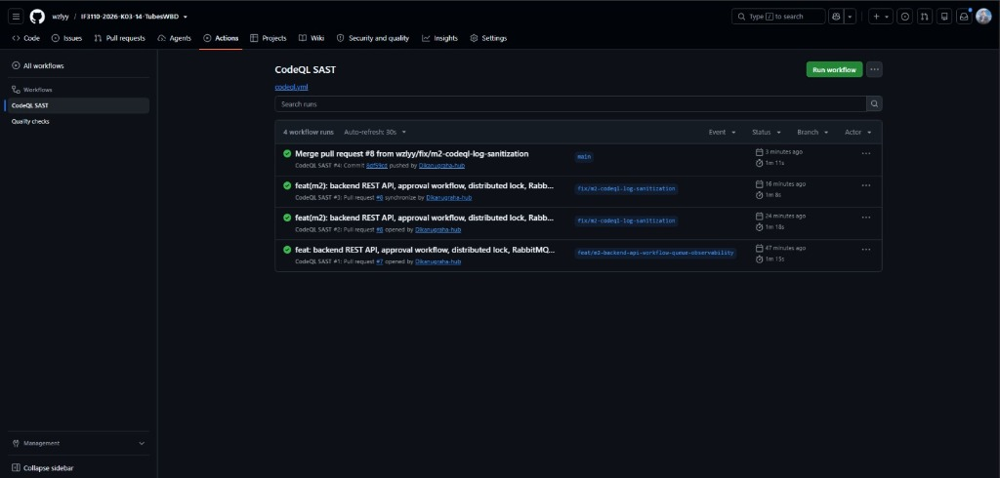
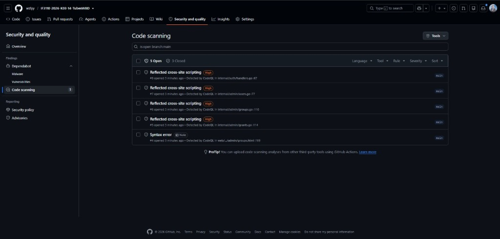
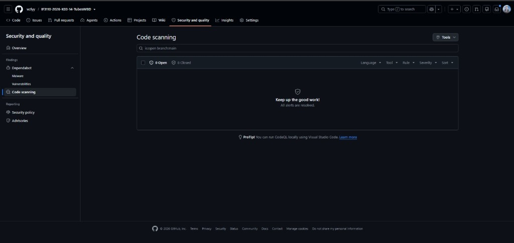

# Laporan Analisis Keamanan CodeQL (SAST)

Dokumen ini mencatat konfigurasi, temuan awal, perbaikan, hasil pemindaian ulang (*rescan*), serta batasan analisis statis (*Static Application Security Testing* / SAST) menggunakan **GitHub CodeQL** pada repositori ini.

## 1. Konfigurasi dan Cakupan Analisis

Workflow CodeQL didefinisikan pada [.github/workflows/codeql.yml](../.github/workflows/codeql.yml) menggunakan `github/codeql-action@v3` dengan paket query **`security-extended`** dan **`security-and-quality`**. Analisis berjalan otomatis pada setiap `push` dan `pull_request` ke branch `main`, serta terjadwal mingguan.

| Matriks Bahasa | Build Mode | Cakupan Berkas yang Dianalisis |
|---|---|---|
| `go` | `autobuild` | Seluruh kode sumber Go pada `cmd/server`, `cmd/worker`, `cmd/seed`, serta seluruh paket `internal/*` (`access`, `admin`, `api`, `auth`, `config`, `database`, `lock`, `migration`, `queue`, `telemetry`, `worker`). |
| `javascript-typescript` | `none` | Seluruh kode SPA React/TypeScript pada `frontend/src/*` serta skrip uji beban k6 pada `tests/k6/stress_test.js`. |

## 2. Temuan CodeQL dan Keputusan Penanganan

Sepanjang pengembangan Milestone 2, GitHub CodeQL mencatat total **10 alert (`#1`–`#10`)** pada tab *Security → Code scanning* (terdiri atas 3 temuan awal pada PR #8, 5 temuan kode legacy Milestone 1 saat pertama kali digabungkan ke `main`, serta 2 temuan lanjutan pasca-merge PR #9 dan PR #11). Seluruhnya telah ditangani melalui perbaikan kode maupun *dismissal* beralasan hingga status **`0 Open`**.

### 2.1 Ringkasan Seluruh Temuan (`#1`–`#10`)

| Alert | Rule ID | Severity | Lokasi Kode | Keputusan | Referensi / Ringkasan Alasan |
|---|---|---|---|---|---|
| `#1`–`#3` (PR #8) | `go/log-injection` (CWE-117) | Medium | [`internal/telemetry/logger.go`](../internal/telemetry/logger.go) (`LogEvent`) & [`internal/telemetry/redact.go`](../internal/telemetry/redact.go) | **Diperbaiki (`6ede7c2`) + Dismiss (*False positive*)** | Perbaikan menghapus CR/LF dan merekonstruksi `slog.Attr` per tipe (`6ede7c2`); residu peringatan taint abstrak via `any` di-*dismiss* karena `slog.NewJSONHandler` melakukan JSON-escaping penuh, CR/LF dibuang eksplisit via `strings.ReplaceAll`, dan nilai sensitif disamarkan. |
| `#1`–`#3` (PR #8) | `go/sql-injection` (CWE-89) | High | [`internal/telemetry/sqllog.go:185`](../internal/telemetry/sqllog.go#L189) (`QueryRowPrepared` untuk `EXPLAIN`) | **Tidak diperbaiki — Dismiss (*By design / Accepted risk*)** | Wrapper khusus fitur `EXPLAIN` yang dilindungi RBAC database, `ValidateExplainSQL` (memblokir multi-statement/DDL/transaksi), batas waktu 5 detik, transaksi `ReadOnly`, dan `Rollback()` wajib. |
| `#1`–`#3` (PR #8) | `go/sql-injection` (CWE-89) | High | [`internal/migration/runner.go:149`](../internal/migration/runner.go#L149) | **Tidak diperbaiki — Dismiss (*By design / Retired M1 runner*)** | Executor migrasi sinkron legacy M1 untuk pengguna `VIEW_EDIT` yang dilindungi CSRF, `ValidateSQL` (memblokir `_platform_meta`/receipts), timeout 8 detik, dan rollback atomik; pada runtime M2 telah digantikan penuh oleh worker asinkron berpersetujuan leader (`internal/worker/`). |
| `#4` | `js/syntax-error` | Note | [`web/templates/admin/groups.html:169`](../web/templates/admin/groups.html#L169) | **Tidak diperbaiki — Dismiss (*False positive / Legacy M1*)** | Berkas adalah template HTML Go (`{{ range .Groups }}` di dalam `<script>`) yang dipindai extractor JS sebagai JavaScript mentah; direktori `web/templates/` sudah tidak dimuat di runtime SPA M2 (`cmd/server/main.go` & `Dockerfile`). |
| `#5` | `go/reflected-xss` (CWE-79) | High | [`internal/admin/grants.go:114`](../internal/admin/grants.go#L114) | **Tidak diperbaiki — Dismiss (*False positive / Retired M1 SSR*)** | Memakai antarmuka `auth.TemplateRenderer` (implementasi M1 memakai `html/template` dengan *contextual auto-escaping*); pada runtime M2 handler SSR ini sudah tidak di-mount dan digantikan sepenuhnya oleh SPA React + REST JSON `/api/v1/admin/*`. |
| `#6` | `go/reflected-xss` (CWE-79) | High | [`internal/admin/groups.go:110`](../internal/admin/groups.go#L110) | **Tidak diperbaiki — Dismiss (*False positive / Retired M1 SSR*)** | Sama seperti Alert `#5`: handler SSR legacy M1 yang tidak lagi di-mount di runtime SPA M2 (hanya dipertahankan di repositori untuk regresi test M1). |
| `#7` | `go/reflected-xss` (CWE-79) | High | [`internal/admin/users.go:77`](../internal/admin/users.go#L77) | **Tidak diperbaiki — Dismiss (*False positive / Retired M1 SSR*)** | Sama seperti Alert `#5`: handler SSR legacy M1 yang tidak lagi di-mount di runtime SPA M2. |
| `#8` | `go/reflected-xss` (CWE-79) | High | [`internal/auth/handlers.go:67`](../internal/auth/handlers.go#L67) | **Tidak diperbaiki — Dismiss (*False positive / Retired M1 SSR*)** | Sama seperti Alert `#5`: handler login SSR legacy M1 yang tidak lagi di-mount di runtime SPA M2 (login runtime menggunakan `POST /api/v1/auth/login` + React SPA). |
| `#9` | `go/sql-injection` (CWE-89) | High | [`internal/telemetry/sqllog.go:147`](../internal/telemetry/sqllog.go#L147) (melalui `ValidateSQL` → `executor_normal.go:20`) | **Diperbaiki (`9fce00a`)** | Menghapus closure `appendStatement` pada `internal/migration/sql.go` menjadi lexer offset integer `lexSQL` dan memisahkan entry point worker `SplitPostgresStatements`. Tertutup bersih pada rescan `CodeQL SAST #14`. |
| `#10` | `js/unused-local-variable` | Note | [`frontend/src/pages/approvals/Review.tsx:44`](../frontend/src/pages/approvals/Review.tsx#L44) | **Diperbaiki (`9fce00a`)** | Menghapus binding `error` yang tidak dipakai pada `useResource<Change>(path)`. Tertutup bersih pada rescan `CodeQL SAST #14`. |

---

### 2.2 Detail Analisis Per Kelompok Temuan

#### A. `go/log-injection` pada Logging Terstruktur (`64ef0d0` → `6ede7c2`)

| Atribut | Detail Temuan |
|---|---|
| **Rule ID** | `go/log-injection` (*Log entries created from user input*, CWE-117) |
| **Severity** | Medium |
| **Lokasi** | [`internal/telemetry/logger.go`](../internal/telemetry/logger.go) (`LogEvent`) dan [`internal/telemetry/redact.go`](../internal/telemetry/redact.go) (`SanitizeLogString`, `RedactParams`) |
| **Sumber & Aliran Taint** | Input permintaan HTTP (seperti header `X-Correlation-ID`, metadata `actor`/`database`, serta atribut dinamis `extra ...slog.Attr`) diteruskan ke `Logger().LogAttrs(...)`. Sebelum perbaikan, `SanitizeLogString` mengganti `\n` menjadi spasi tanpa menghapus karakter kontrol secara konsisten dan cabang `default` pada `RedactParams` belum menyanitasi hasil `fmt.Sprint(v)`. |
| **Potensi Dampak** | Jika baris log diproses agregator berbasis teks tanpa escaping JSON, karakter CR/LF (`\r`, `\n`) dari input eksternal dapat menyuntikkan entri log palsu (*log forging/injection*) dan merusak keutuhan audit trail. |
| **Keputusan** | **Diperbaiki di kode (`6ede7c2`)**, lalu residu alert taint abstrak melalui `any` pada PR #8 di-*dismiss* sebagai **False positive**. |
| **Commit Perbaikan** | [`6ede7c2`](https://github.com/wzlyy/IF3110-2026-K03-14-TubesWBD/commit/6ede7c20fa760f8595a3138260f70217164b722b) (*"fix(security): rekonstruksi atribut slog agar bebas taint log-injection CodeQL"*) |

Ringkasan perbaikan (`6ede7c2`) & justifikasi penutupan residu alert:
1. **`internal/telemetry/redact.go`**: `SanitizeLogString` menghapus seluruh karakter `\n` dan `\r` dengan string kosong (`""`), dan `RedactParams` menyanitasi cabang `default` dengan `SanitizeLogString(RedactString(fmt.Sprint(v)))`.
2. **`internal/telemetry/logger.go`**: Seluruh field inti, metadata job, dan setiap elemen `extra ...slog.Attr` direkonstruksi ulang berdasarkan `attr.Value.Kind()` dengan penghapusan eksplisit `\r`/`\n` via `strings.ReplaceAll` serta redaksi `IsSensitiveKey(key)` → `[REDACTED]`.
3. **Verifikasi & alasan *false positive* residu**: `slog.NewJSONHandler` selalu melakukan JSON-escaping terhadap seluruh nilai keluaran dan unit test `TestRedactionMasksSecretsAndDSNs` pada [`internal/telemetry/telemetry_test.go`](../internal/telemetry/telemetry_test.go) memverifikasi penghapusan `\r`/`\n` serta penyamaran secret.

#### B. `go/sql-injection` *By Design* pada Wrapper `EXPLAIN` & Runner Legacy M1 (PR #8)

| Atribut | Detail Temuan |
|---|---|
| **Rule ID** | `go/sql-injection` (*Database query built from user-controlled sources*, CWE-89) |
| **Severity** | High |
| **Lokasi** | [`internal/telemetry/sqllog.go:185`](../internal/telemetry/sqllog.go#L189) (`QueryRowPrepared`, dipanggil dari `database.RunExplain`) dan [`internal/migration/runner.go:149`](../internal/migration/runner.go#L149) |
| **Potensi Dampak** | Menjalankan SQL dari input pengguna tanpa batas otorisasi/validasi dapat menyebabkan modifikasi data tidak sah atau manipulasi skema internal platform. |
| **Keputusan** | **Tidak diperbaiki — Dismiss (*By design / Accepted risk*)** karena menjalankan SQL pengguna secara terkontrol merupakan fungsi inti *Database Management Platform*. |
| **Mitigasi Teknis** | 1. **`sqllog.go` (`EXPLAIN`)**: Dilindungi DB RBAC, `ValidateExplainSQL` (memblokir multi-statement, DDL, dan kontrol transaksi), timeout server 5 detik, transaksi `ReadOnly` (untuk non-ANALYZE), serta `defer tx.Rollback()` wajib sehingga tidak ada mutasi data yang ter-commit. 2. **`runner.go` (M1 legacy)**: Dilindungi izin `VIEW_EDIT`, proteksi CSRF, `ValidateSQL` (memblokir akses ke `_platform_meta` & tabel receipt), timeout 8 detik, dan rollback atomik; pada runtime M2 alur eksekusi telah dipindahkan ke worker asinkron berpersetujuan leader multi-grup (`internal/worker/`). |

#### C. Alerts `#4`–`#8` — Kode SSR & Template Legacy Milestone 1 (`8df59cd` di `main`)

| Atribut | Detail Temuan |
|---|---|
| **Alert & Rule ID** | Alert `#4`: `js/syntax-error` (*Note*) pada [`web/templates/admin/groups.html:169`](../web/templates/admin/groups.html#L169) Alerts `#5`–`#8`: `go/reflected-xss` (*High*, CWE-79) pada [`internal/admin/grants.go:114`](../internal/admin/grants.go#L114), [`internal/admin/groups.go:110`](../internal/admin/groups.go#L110), [`internal/admin/users.go:77`](../internal/admin/users.go#L77), dan [`internal/auth/handlers.go:67`](../internal/auth/handlers.go#L67) |
| **Sumber & Aliran Taint** | Pada `#4`, extractor JavaScript CodeQL membaca sintaks Go template `{{ range .Groups }}` di dalam tag `<script>` sebagai error sintaks JS. Pada `#5`–`#8`, handler SSR M1 mengirim `r.URL.Query().Get(...)` / `username` ke `h.Templates.ExecuteTemplate(w, ...)` yang bertipe antarmuka `auth.TemplateRenderer`, sehingga CodeQL tidak dapat membuktikan secara statis bahwa implementasi konkretnya memakai `html/template`. |
| **Potensi Dampak** | Jika handler SSR tersebut dipakai dengan `text/template` tanpa escaping di runtime, parameter query dapat memicu *Reflected XSS*. |
| **Keputusan** | **Tidak diperbaiki — Dismiss (*False positive / Retired legacy M1 SSR code*)**. |
| **Justifikasi Teknis** | Seluruh halaman aplikasi pada Milestone 2 telah dipindahkan 100% ke **React SPA** (`frontend/dist`) dan **REST JSON API** (`/api/v1/*`). Baik [`cmd/server/main.go`](../cmd/server/main.go) maupun [`Dockerfile`](../Dockerfile) **tidak lagi me-mount handler SSR lama maupun membundel `web/templates/`** ke image produksi (kode lama hanya tersisa di repo agar test regresi paket internal M1 tetap berjalan, dan di M1 sendiri menggunakan `html/template` dengan *contextual auto-escaping*). |

#### D. Alert `#9` — `go/sql-injection` pada Jalur Worker Normal (`7ea5343` / PR #9)

| Atribut | Detail Temuan |
|---|---|
| **Rule ID** | `go/sql-injection` (*Database query built from user-controlled sources*, CWE-89) |
| **Severity** | High / Error |
| **Lokasi** | [`internal/telemetry/sqllog.go:147`](../internal/telemetry/sqllog.go#L147) (`(*InstrumentedTx).ExecContext`, dipanggil dari [`internal/worker/executor_normal.go:20`](../internal/worker/executor_normal.go#L20)) |
| **Sumber & Aliran Taint** | CodeQL menelusuri input HTTP (`DecodeJSON` di [`internal/api/m2_handlers.go:140`](../internal/api/m2_handlers.go#L140) melalui `ValidateDefinitionInput`, serta `r.PostForm.Get` di [`internal/migration/editor_handlers.go:94,118`](../internal/migration/editor_handlers.go#L94)) ke `migration.ValidateSQL`. Di dalam `ValidateSQL`, closure bersarang `appendStatement` menangkap variabel `query` dan `statements` (*SSA implicit def*), sehingga menghilangkan *1-level call-context sensitivity* dan membuat kembalian `ValidateSQL` di [`internal/worker/executor_normal.go:10`](../internal/worker/executor_normal.go#L10) dianggap tercemar hingga ke `t.Tx.ExecContext` (`sqllog.go:147`). |
| **Potensi Dampak** | Secara fungsional worker hanya mengeksekusi *snapshot* SQL migrasi yang telah disetujui seluruh *group leader* dan bersifat *immutable* di tabel `migration_definitions` (dengan blokir kontrol transaksi dan skema internal `_platform_meta`). Namun jika suatu pemanggil tidak melalui validasi dan approval, eksekusi statement SQL mentah berisiko mengubah atau merusak data pada database target. |
| **Keputusan** | **Diperbaiki (*Fixed / Remediated*)** — menghilangkan kebocoran taint lintas pemanggil pada `ValidateSQL`. |
| **Perbaikan** | Menghapus closure `appendStatement` di [`internal/migration/sql.go`](../internal/migration/sql.go) dengan menggantinya menjadi lexer berbasis offset bilangan bulat `lexSQL` (mengembalikan indeks awal/akhir `[]int` dan konstanta kata kunci dari `canonicalSQLKind`), serta memisahkan entry point worker `SplitPostgresStatements` untuk [`internal/worker/executor_normal.go`](../internal/worker/executor_normal.go). |
| **Commit Perbaikan** | [`9fce00a`](https://github.com/wzlyy/IF3110-2026-K03-14-TubesWBD/commit/9fce00a) (*"fix(codeql): fix issue #9 and # 10"*) |
| **Hasil Rescan** | [`45833937684`](https://github.com/wzlyy/IF3110-2026-K03-14-TubesWBD/actions/runs/45833937684) (`CodeQL SAST #14`) — **Success / Alert #9 tertutup (`0 open alert`)** |

#### E. Alert `#10` — `js/unused-local-variable` pada SPA (`1311887` / PR #11)

| Atribut | Detail Temuan |
|---|---|
| **Rule ID** | `js/unused-local-variable` (*Unused variable, import, function or class*) |
| **Severity** | Note |
| **Lokasi** | [`frontend/src/pages/approvals/Review.tsx:44`](../frontend/src/pages/approvals/Review.tsx#L44) |
| **Sumber & Aliran** | Variabel destrukturisasi `error` pada `const { data: r, error, refresh } = useResource<Change>(path);` tertinggal tidak terpakai setelah `<Feedback>` dihapus pada konsolidasi hook di commit `8c595b4`. |
| **Potensi Dampak** | Tidak berdampak keamanan langsung, namun menurunkan kebersihan kode dan dapat menutupi kesalahan penanganan error lokal bila nanti ada refaktorisasi. |
| **Keputusan** | **Diperbaiki (*Fixed / Remediated*)** |
| **Perbaikan** | Menghapus binding `error` yang tidak dipakai menjadi `const { data: r, refresh } = useResource<Change>(path);` di [`frontend/src/pages/approvals/Review.tsx`](../frontend/src/pages/approvals/Review.tsx#L44) dan memverifikasi dengan `tsc --noUnusedLocals --noUnusedParameters`. |
| **Commit Perbaikan** | [`9fce00a`](https://github.com/wzlyy/IF3110-2026-K03-14-TubesWBD/commit/9fce00a) (*"fix(codeql): fix issue #9 and # 10"*) |
| **Hasil Rescan** | [`45833937684`](https://github.com/wzlyy/IF3110-2026-K03-14-TubesWBD/actions/runs/45833937684) (`CodeQL SAST #14`) — **Success / Alert #10 tertutup (`0 open alert`)** |

## 3. Rekam Jejak Pemindaian (*Scan* & *Rescan*) dan Bukti Screenshot

| Commit / Tahap | Konteks | Run ID | Hasil Scan & Status Alert |
|---|---|---|---|
| `6ede7c2` | Branch `fix/m2-codeql-log-sanitization` (PR #8) setelah perbaikan sanitasi `go/log-injection` | [`45046275169`](https://github.com/wzlyy/IF3110-2026-K03-14-TubesWBD/actions/runs/45046275169) | Workflow **Success**; 3 alert PR #8 (`sqllog.go:185`, `runner.go:149`, residu `logger.go`) ditinjau dan di-*dismiss* beralasan (`3 Closed`) |
| `8df59cd` | Merge PR #8 ke `main` (backend M2) | [`45047490984`](https://github.com/wzlyy/IF3110-2026-K03-14-TubesWBD/actions/runs/45047490984) | Workflow **Success**; memunculkan 5 alert legacy M1 (`#4`–`#8`) di `main` yang kemudian di-*dismiss* (`0 Open, 8 Closed`) |
| `7ea5343` | Merge PR #9 ke `main` (menambah worker/SPA) | [`45200770227`](https://github.com/wzlyy/IF3110-2026-K03-14-TubesWBD/actions/runs/45200770227) | Workflow **Success**; memunculkan **Alert `#9`** (`go/sql-injection`) |
| `1311887` | Merge PR #11 ke `main` (`CodeQL SAST #13`) | [`45824302384`](https://github.com/wzlyy/IF3110-2026-K03-14-TubesWBD/actions/runs/45824302384) | Workflow **Success**; **Alert `#9`** (Go) & **Alert `#10`** (JS/TS) berstatus Open |
| [`9fce00a`](https://github.com/wzlyy/IF3110-2026-K03-14-TubesWBD/commit/9fce00a) | Push perbaikan Alert `#9` (`sql.go`, `executor_normal.go`) & Alert `#10` (`Review.tsx`) ke `main` (`CodeQL SAST #14`) | [`45833937684`](https://github.com/wzlyy/IF3110-2026-K03-14-TubesWBD/actions/runs/45833937684) | **Success — `0 Open` alert; Alert `#9` & `#10` tertutup (*Fixed*)** |
| [`af0f12c`](https://github.com/wzlyy/IF3110-2026-K03-14-TubesWBD/commit/af0f12c) | Merge PR #12 ke `main` (`CodeQL SAST #17`) | [`45865135522`](https://github.com/wzlyy/IF3110-2026-K03-14-TubesWBD/actions/runs/45865135522) | **Success — `0 Open` alert** (Go & JS/TS) |
| [`b01bbd4`](https://github.com/wzlyy/IF3110-2026-K03-14-TubesWBD/commit/b01bbd4) | Merge PR #13 ke `main` (`CodeQL SAST #19`) | [`45910962063`](https://github.com/wzlyy/IF3110-2026-K03-14-TubesWBD/actions/runs/45910962063) | **Success — `0 Open` alert** (Go & JS/TS) |
| [`7052110`](https://github.com/wzlyy/IF3110-2026-K03-14-TubesWBD/commit/7052110) | Pemindaian terakhir pada kode produksi di `main` (`CodeQL SAST #20`) | [`45915919642`](https://github.com/wzlyy/IF3110-2026-K03-14-TubesWBD/actions/runs/45915919642) | **Success — `0 Open` alert** (`Analyze (go)` & `Analyze (javascript-typescript)` lulus) |

Verifikasi CI tambahan: workflow *Quality checks #32* pada `9fce00a` selesai **Success** pada [Run `45833937735`](https://github.com/wzlyy/IF3110-2026-K03-14-TubesWBD/actions/runs/45833937735), dan pada `7052110` workflow *Quality checks #42* (Go `vet`/test, TypeScript check, `vite build`, dan `govulncheck`) turut selesai dengan status **Success** pada [Run `45915919577`](https://github.com/wzlyy/IF3110-2026-K03-14-TubesWBD/actions/runs/45915919577).

### Bukti Screenshot GitHub Actions & Code Scanning

1. **Eksekusi Workflow `CodeQL SAST` (GitHub Actions — Go & JavaScript/TypeScript)**

   

2. **Deteksi Temuan Awal pada Branch `main` (`5 Open` `#4`–`#8`, `3 Closed` `#1`–`#3`)**

   

3. **Hasil Penanganan & Triage Alert pada Branch `main` (`0 Open` — Seluruh Alert Terselesaikan)**

   

## 4. Batasan Analisis Statis (SAST)

Hasil pemindaian CodeQL yang bersih (**`0 Open` alert** pada kode Go dan JavaScript/TypeScript) **tidak menjamin aplikasi bebas dari seluruh celah keamanan**. Keterbatasan mendasar SAST mencakup:

1. **Cacat logika bisnis dan otorisasi dinamis:** SAST tidak memverifikasi kebenaran semantik aturan kuorum persetujuan leader lintas grup, aturan linearitas forward/LIFO rollback, ataupun penolakan eksekusi ketika grant berubah setelah persetujuan. Kontrol ini diverifikasi melalui *integration test* pada [`internal/migration/m2_integration_test.go`](../internal/migration/m2_integration_test.go).
2. **Kondisi pacu (*race condition*) dan ketahanan *distributed lock*:** SAST statis tidak menyimulasikan interleaving antar worker, kedaluwarsa lease, maupun crash saat transaksi target. Perilaku tersebut diuji dengan skenario konkurensi dan pemulihan pada [`internal/worker/worker_integration_test.go`](../internal/worker/worker_integration_test.go).
3. **Kesalahan konfigurasi lingkungan (*deployment misconfiguration*):** Keamanan produksi tetap bergantung pada manajemen rahasia yang benar (`ENCRYPTION_KEY` 32-byte yang privat, `ADMIN_INITIAL_PASSWORD` yang kuat, `COOKIE_SECURE=true` di balik HTTPS, isolasi port database target/RabbitMQ, dan tidak membuka port Collector/Grafana/Prometheus secara publik).
4. **Kerentanan dependensi pihak ketiga dan perilaku runtime DBMS:** CodeQL berfokus pada aliran kode sumber aplikasi; kerentanan paket pihak ketiga dipantau terpisah oleh `govulncheck` di [`.github/workflows/quality.yml`](../.github/workflows/quality.yml), sedangkan validasi SQL tetap dibatasi oleh hak akses akun database target PostgreSQL.
